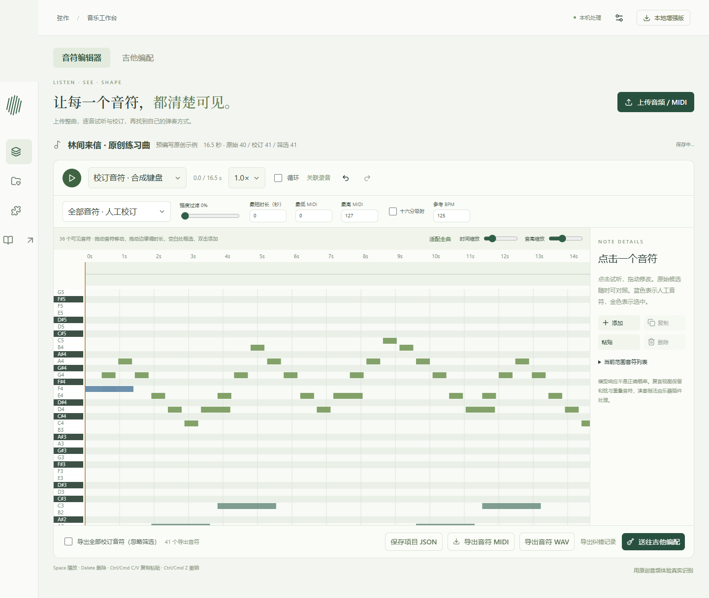

<div align="center">

# 弦作 Stringcraft

**让喜欢的旋律，在指尖响起。**

浏览器里的整曲音符编辑器：看见全部复音，逐音试听、校订与导出，再交给吉他插件编配。

[在线工作台](https://h0ll0w-akuzr0guy.github.io/Stringcraft/) · [下载本地增强版](https://github.com/h0ll0w-AkuZr0guY/Stringcraft/releases) · [开发文档](docs/DEVELOPMENT.md)


</div>



## 本地试用优先

当前开发版本为 0.2.0-local.3，暂不更新公开站点。新增独立音乐编配插件，将原始识别、整理后的乐句和吉他动作分别保存；扫弦加入重音、弦组与句尾留白，指弹按整句搜索弦位并保护旋律骨干，分解伴奏保留原有节奏。完整本地包增加人声旋律证据和多力度实录音源。复杂混音仍需校订，详见 [本地试用说明](docs/LOCAL_TRIAL.md)、[音乐验收](docs/MUSICAL_DEVELOPMENT.md) 和 [质量记录](docs/QUALITY.md)。在线链接仍对应上次公开预览。

## 从一段喜欢的音乐开始

1. 上传音频即可自动识别整曲，在线支持 5 分钟 / 50 MB；也可导入 MIDI、MusicXML 或项目 JSON。
2. 音符约每 6 秒逐段出现。点击发声，拖动移动与调时长，框选、复制、删除、撤销；随时对照原始候选。
3. 过滤强度、时长与音域，切换原录音/合成键盘试听，直接导出 MIDI、WAV 与项目。
4. 需要吉他谱时点“送往吉他编配”，再校正节拍、和弦及弹奏目标。原有吉他工作台保留。

详见[音符编辑器与开发入口](docs/NOTE_EDITOR.md)。

首次打开展示原创练习曲，**示例音符为预先编写，未经识别**。上传音频后运行真实 Basic Pitch 模型，不会以示例结果替换你的输入。浏览器版本参考速度暂设 120 BPM，请按实际音乐调整。谱面节奏量化与原始识别时序分别保存。

## 已有能力与边界

| 能力 | 当前实现 |
| --- | --- |
| 在线转谱 | Basic Pitch WASM Worker 整曲分块识别，保留复音与原始候选 |
| 音符编辑器 | 虚拟化卷帘、逐音试听、拖动/框选、增删与撤销、无损筛选、直接 MIDI/WAV 导出 |
| 校谱与练习 | 可点击六线谱、近似节奏谱、音符编辑/锁定、撤销重做、循环与速度 |
| 音色 | CC0 钢弦/尼龙实录采样；缺失音域明确回退合成 |
| 项目保存 | 当前浏览器 IndexedDB 自动保存；导出 JSON 备份 |
| 插件中心 | 官方预构建插件、SHA-256 校验、启停/安装/卸载/恢复、版本兼容 |
| 可选 AI | 自带百炼 Key，比选本地变调夹候选，不上传音频或完整音符序列 |
| 本地增强（实验） | 独立 Python、FFmpeg、Basic Pitch ONNX、HTDemucs 和冻结 BTC 和弦网络；分离试听、和声对照、实际设备记录 |
| 其他乐器、图片/PDF 识谱 | 后续插件；目前只正式实现标准调弦六弦吉他 |

这是 **0.2.0 预览版**。复杂混音可能产生明显错音、漏音，旋律追踪与可演奏性仍是启发式；暂未通过真人试弹或真实歌曲质量发布门槛。吉他伴奏采用和弦指型与节奏型，指弹采用结构声部；不会把生成和声伪装为原曲识别。请查看[质量记录](docs/QUALITY.md)，不要把合成测试成绩理解为真实流行歌曲准确率。

当前实际操作录屏见 [音符编辑器演示](docs/assets/note-editor-demo.mp4)，使用原创合成测试音频，无音轨。旧 0.1 下载包保留在原 Release。

## 在线与本地

Pages 承载真实应用，基础音频分析发生在访问者的浏览器，整曲编辑器单文件上限 50 MB、时长上限 5 分钟；吉他工作台的旧片段分析仍支持 1–60 秒。支持格式取决于浏览器解码器。本地增强模式文件上限 200 MB，单次最多 30 分钟，浏览器仍需解码原录音用于对照，长文件消耗更多内存。当前 full 试用包附带运行库和权重；preview 基础包可另外装环境。

本地基础包启动后打开 `http://127.0.0.1:18765/`；增强环境包解压到应用同目录的 `runtime_plugins/`。没有安装增强环境时仍可运行浏览器工作台。模型首次下载和完整离线条件见[构建与分发](docs/BUILDING.md)。

## 开发

需要 Node.js 22+ 与 Python 3.11+。Python 服务可选；重计算环境单独使用 Python 3.11。

```sh
npm ci
npm run plugins:build
npm run docs:build
npm run dev
```

```sh
npm run check
npm run build
python -m pip install -r backend/requirements.txt httpx
python -m unittest discover -s tests -p '*_test.py'
```

[AGENTS.md](AGENTS.md) 是其他 AI 的开发入口。新增功能先查公共接口与插件模板，说明需要改变框架的理由。仓库只包含可公开源码、CC0 采样与明确标注的原创合成测试音频。

## 文档导航

| 文档 | 内容 |
| --- | --- |
| [使用指南](docs/USAGE.md) | 在线/本地、导入、编辑、试听、备份与故障排查 |
| [架构](docs/ARCHITECTURE.md) | 分层、依赖方向、时间模型与任务生命周期 |
| [公共接口](docs/REUSABLE_INTERFACES.md) | SDK、项目、插件与本地 API 契约 |
| [开发指南](docs/DEVELOPMENT.md) | 环境、插件扩展、调试与示例 |
| [贡献规范](docs/CONTRIBUTING.md) | Issue、PR、AI 协作与变更记录 |
| [构建发布](docs/BUILDING.md) | CI、Pages、Windows 基础包与模型环境 |
| [隐私](docs/PRIVACY.md) | 本地数据、API Key 与网络请求 |
| [质量](docs/QUALITY.md) | 已验证范围、评估方法与发布门槛 |
| [路线图](docs/ROADMAP.md) | 阶段进度、乐器与识谱扩展 |

## 许可与致谢

自有代码使用 Apache License 2.0；Basic Pitch、TensorFlow.js、alphaTab、Meta Open Sound 和本地模型各自保留原许可。详见 [NOTICE](NOTICE) 与[第三方许可](docs/LICENSING.md)。项目工程组织参考作者的 [MiaoTask](https://github.com/h0ll0w-AkuZr0guY/MiaoTask)，音乐算法与运行形态独立维护。

## 下一步

纠错记录可在本地导出，尚未接入训练。下一阶段按固定参考标注比较识别和编配，增加模型适配与钢琴双手/踏板插件。实现与未完成验收见 [音乐开发验收](docs/MUSICAL_DEVELOPMENT.md) 和 [音符编辑器](docs/NOTE_EDITOR.md)。
