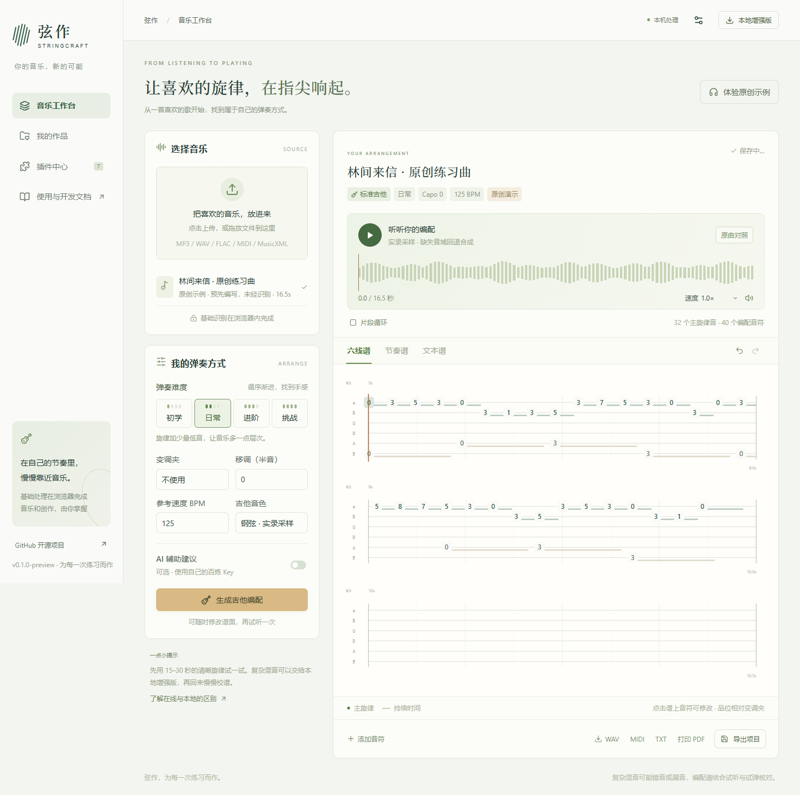

<div align="center">

# 弦作 Stringcraft

**让喜欢的旋律，在指尖响起。**

浏览器里的音乐转吉他工作台：识别片段、生成分级编配、编辑六线谱，再听一次。

[在线工作台](https://h0ll0w-akuzr0guy.github.io/Stringcraft/) · [下载本地增强版](https://github.com/h0ll0w-AkuZr0guY/Stringcraft/releases) · [开发文档](docs/DEVELOPMENT.md)


</div>



## 从一段喜欢的音乐开始

1. 打开在线工作台，上传音频，选择 1–60 秒片段；也可导入 MIDI 或未压缩 MusicXML。
2. 分析后选择难度、变调夹与移调，生成吉他编配。浏览器基础处理无需 API Key。
3. 点击六线谱音符修改起音、时长、弦和品位。修改自动锁定，重新生成时保留；可撤销、重做。
4. 对照原音频试听，分段循环、慢速练习，导出 WAV、MIDI、TXT、项目或打印 PDF。

首次打开展示原创练习曲，**示例音符为预先编写，未经识别**。上传音频后运行真实 Basic Pitch 模型，不会以示例结果替换你的输入。浏览器版本参考速度暂设 120 BPM，请按实际音乐调整。谱面节奏量化与原始识别时序分别保存。

## 已有能力与边界

| 能力 | 当前实现 |
| --- | --- |
| 在线转谱 | Basic Pitch WASM Worker、旋律连续性追踪、四档吉他约束编配 |
| 校谱与练习 | 可点击六线谱、近似节奏谱、音符编辑/锁定、撤销重做、循环与速度 |
| 音色 | CC0 钢弦/尼龙实录采样；缺失音域明确回退合成 |
| 项目保存 | 当前浏览器 IndexedDB 自动保存；导出 JSON 备份 |
| 插件中心 | 官方预构建插件、SHA-256 校验、启停/安装/卸载/恢复、版本兼容 |
| 可选 AI | 自带百炼 Key，比选本地变调夹候选，不上传音频或完整音符序列 |
| 本地增强 | 独立环境中的 FFmpeg、Basic Pitch、HTDemucs 与人声单旋律提取 |
| 其他乐器、图片/PDF 识谱 | 后续插件；目前只正式实现标准调弦六弦吉他 |

这是 **0.1.0 预览版**。复杂混音可能产生明显错音、漏音，旋律追踪与可演奏性仍是启发式；暂未通过真人试弹或真实歌曲质量发布门槛。首版高难度优先保留输入中已有的伴随声部，不会把生成和声伪装为原曲识别。请查看[质量记录](docs/QUALITY.md)，不要把合成测试成绩理解为真实流行歌曲准确率。

当前实际操作录屏见 [预览版附件](https://github.com/h0ll0w-AkuZr0guY/Stringcraft/releases/tag/v0.1.0-preview)，使用合成测试音频，无音轨。

## 在线与本地

Pages 承载真实应用，基础音频分析发生在访问者的浏览器，单文件上限 50 MB、单次片段上限 60 秒。支持格式取决于浏览器解码器。复杂整曲可下载本地增强版，文件上限 200 MB，单次最多 30 分钟。基础包与重计算环境分别下载，插件更新不要求重新下载主程序。

本地基础包启动后打开 `http://127.0.0.1:18765/`；增强环境包解压到应用同目录的 `runtime_plugins/`。没有安装增强环境时仍可运行浏览器工作台。模型首次下载和完整离线条件见[构建与分发](docs/BUILDING.md)。

## 开发

需要 Node.js 22+ 与 Python 3.11+。Python 服务可选；重计算环境单独使用 Python 3.11。

```sh
npm ci
npm run plugins:build
npm run docs:build
npm run dev
```

```sh
npm run check
npm run build
python -m pip install -r backend/requirements.txt httpx
python -m unittest discover -s tests -p '*_test.py'
```

[AGENTS.md](AGENTS.md) 是其他 AI 的开发入口。新增功能先查公共接口与插件模板，说明需要改变框架的理由。仓库只包含可公开源码、CC0 采样与明确标注的原创合成测试音频。

## 文档导航

| 文档 | 内容 |
| --- | --- |
| [使用指南](docs/USAGE.md) | 在线/本地、导入、编辑、试听、备份与故障排查 |
| [架构](docs/ARCHITECTURE.md) | 分层、依赖方向、时间模型与任务生命周期 |
| [公共接口](docs/REUSABLE_INTERFACES.md) | SDK、项目、插件与本地 API 契约 |
| [开发指南](docs/DEVELOPMENT.md) | 环境、插件扩展、调试与示例 |
| [贡献规范](docs/CONTRIBUTING.md) | Issue、PR、AI 协作与变更记录 |
| [构建发布](docs/BUILDING.md) | CI、Pages、Windows 基础包与模型环境 |
| [隐私](docs/PRIVACY.md) | 本地数据、API Key 与网络请求 |
| [质量](docs/QUALITY.md) | 已验证范围、评估方法与发布门槛 |
| [路线图](docs/ROADMAP.md) | 阶段进度、乐器与识谱扩展 |

## 许可与致谢

自有代码使用 Apache License 2.0；Basic Pitch、TensorFlow.js、alphaTab、Meta Open Sound 和本地模型各自保留原许可。详见 [NOTICE](NOTICE) 与[第三方许可](docs/LICENSING.md)。项目工程组织参考作者的 [MiaoTask](https://github.com/h0ll0w-AkuZr0guY/MiaoTask)，音乐算法与运行形态独立维护。

## 0.2 开发分支

音乐结构、和弦伴奏、乐器动作与已知谱往返正在重建。实现与未完成验收集中见 [音乐开发验收](docs/MUSICAL_DEVELOPMENT.md)。公开 0.1 预览的测试不能证明新版实曲识别或真人可演奏性。
