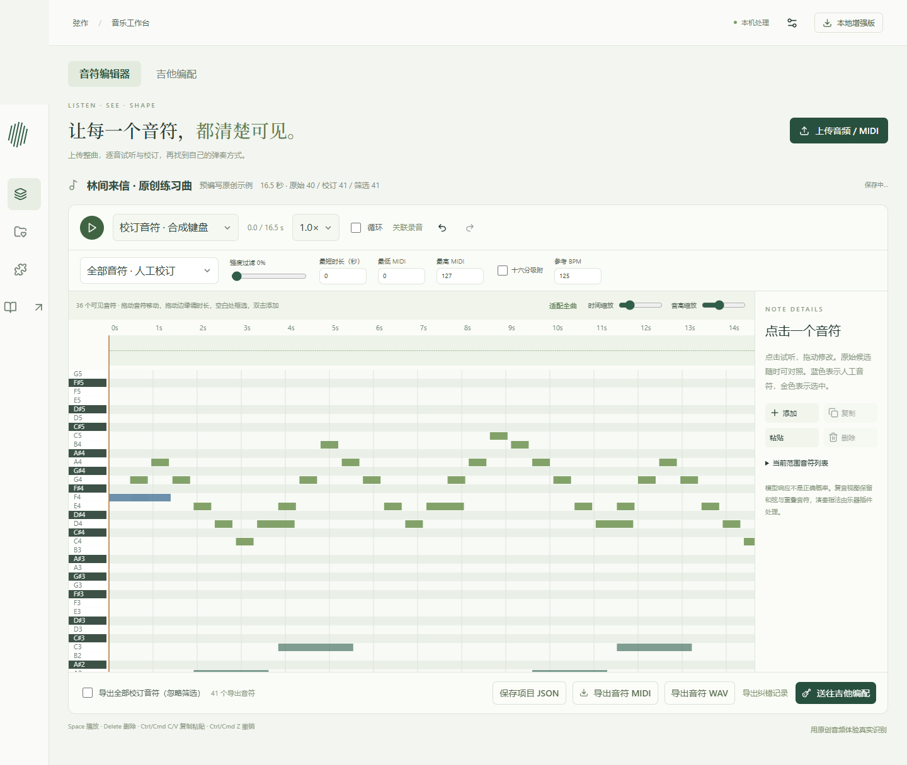

# 整曲音符编辑器

0.2.0-preview.1 的默认入口。先观察、试听和校订所有复音，再由乐器插件决定怎样演奏。无需 API Key，也无需先生成吉他谱。

[实际操作录屏](assets/note-editor-demo.mp4)使用原创合成音频，包含真实识别、逐音试听、修改/撤销、播放与导出；视频无音轨。

## 上手

1. 上传 MP3/WAV/FLAC 等浏览器可解码音频，最多 5 分钟、50 MB；文件选择与拖放都自动启动整曲识别。MIDI/MusicXML/项目 JSON 直接导入。
2. 音符约每 6 秒逐段显示，灰色区域尚未处理。可以边识别边校订。停止保留已完成部分；换文件会取消旧任务，旧结果不会覆盖新项目。超限直接提示，不悄悄截断。
3. 点击音符或左侧琴键试听。拖动音符调整起音/音高，左右边缘调时长；空白框选，Shift 点击多选，双击空白新增。右侧可精确修改 MIDI 音高、秒起音、秒时长和力度。
4. Space 播放，Delete/Backspace 删除，Ctrl/Cmd C/V 复制粘贴，Ctrl/Cmd Z 撤销，Ctrl/Cmd Shift Z 或 Y 重做；上下键移半音，配合 Ctrl/Cmd 移八度。
5. 默认使用自由秒时间；可选十六分吸附。参考 BPM 不改变已有音符时序。时间/音高缩放与“适配全曲”用于观察密集段，滚动只绘制视口事件。
6. 选择音符合成试听或原始/参考录音，点击时间尺/波形定位，支持循环和慢速。合成键盘使用三角波近似音色；原录音变速会改变音高。
7. 过滤强度、最短时长和音域，只改变显示/试听/导出投影，不删除原始候选。“原始候选”与“主旋律候选”图层只读，便于对照。主旋律在明确送往吉他流程后提取。
8. 直接导出音符 MIDI、WAV、项目 JSON。默认导出当前图层的筛选结果；勾选“全部校订音符”则忽略图层/筛选。未完成识别的文件名标记“部分转录”。项目 JSON 始终保留原始层、编辑层和进度。

送往吉他编配会明确采用当前校订与筛选结果，随后仍需确认节拍和和弦。吉他技法、指型、声部与可演奏性保留在吉他插件；复音卷帘不把吉他限制套到钢琴上。完整钢琴双手分配、指法和踏板尚未交付。

## 借鉴与选择

研究参考 [hear-score 源码](https://github.com/LiRenTech/hear-score)、[在线体验](https://hear-score.lirentech.net/) 和 [Basic Pitch 论文](https://arxiv.org/html/2203.09893v2)。上游与本项目均使用官方 @spotify/basic-pitch 1.0.1，因此此次可见价值主要来自工作流和交互重建，未宣称换用了更准确的新网络。

| 观察到的方向 | 本次实现 |
| --- | --- |
| 上传后直接观察全部音符 | 默认整曲复音卷帘，不先经过单旋律或吉他筛选 |
| 分块、逐步反馈 | 6 秒分块，左右 0.5 秒上下文，任务可取消保留 |
| 音符强度与时长过滤 | 非破坏式投影，原始候选独立保存 |
| 逐音试听与 MIDI | 点击琴键/事件、原录音对照、直接复音 MIDI |
| 人工校正 | 稳定 ID 覆盖层、删除屏蔽、100 步有界历史、JSON 往返 |
| 乐器扩展 | 卷帘/音源/导出插件独立于吉他动作，保留钢琴插件空间 |

未复制 hear-score 源码或资源；许可核查与官方模型分发见 [第三方许可](LICENSING.md)。

## 识别与编辑不变量

`MusicProject.notes` 保存原始候选。`noteEditor` 保存 ID 覆盖、删除、命令历史和筛选。新分块延长同一候选时，不覆盖人工修正。撤销删除会显露最新原始候选。历史超过 100 个命令后，最旧命令折叠为 base，项目仍可恢复当前校订。

分块解码使用起音所有权与重叠上下文拼接；边界持续音沿用 ID，真实同音重弹保留独立起音。模型仍可能误判重弹、延音与和弦，自动拼接不能替代逐音检查。强度是模型激活值，未经正确率校准。

原始模型、代码摘要、处理进度、音频摘要、修正前后音符与编辑操作可导出为本地纠错记录。记录不含音频、Key，不上传，也不自动训练。它为下一阶段的冻结预训练核与可训练适配头提供数据接口。

## 实测与可重复验证

2026-11-23，Windows Edge 生产构建：

| 检查 | 观察结果 |
| --- | --- |
| 用户授权《晴天》整曲，仅在本机 | 269.7467 秒全部处理；3,974 候选；最后起音 268.7154 秒；耗时 52.44 秒 |
| 10,000 音符项目 | 导入约 0.16 秒；20 次滚动帧约 0.32 秒；只索引/绘制可见音符 |
| 编辑与导出 | 点击试听、移动/边缘时长、音高编辑、复制/删除/撤销、过滤保留原始层、MIDI/WAV 与项目往返通过 |
| 任务生命周期 | 合成 120 秒输入的停止保留、处理中人工编辑、换文件隔离通过 |
| 普通浏览器回归 | 17 通过，6 个显式启用测试跳过；包含旧吉他、录音关联、MusicXML 与打印流程 |
| 单元与公共源码检查 | 79 项单测通过，类型检查与源码/文档链接检查通过 |

耗时仅描述该次本机运行，不保证其他设备表现。《晴天》混音没有完整逐音真值，以上不作为准确率、技巧识别或真人演奏验收。私人录音、识别结果与截图不进入公开仓库。公开演示使用原创合成 fixture。

复现：`npm run check`、`npm run build`、`npm run test:e2e`。Windows 可指定 `PLAYWRIGHT_CHANNEL=msedge`。参考谱与识别评估继续采用 [评估协议](REFERENCE_EVALUATION.md)，分别报告音高/起音/延音/和弦、声部及演奏约束，不能用音符数或密度代替质量。

## 后续开发顺序

1. 固定有授权的标注音频与开发/留出集，比较当前整曲入口与替代识别器的起音、音高和延音误差，保留逐曲退化记录。
2. 新建独立本地训练插件，显式导入纠错记录，冻结预训练核并训练适配层；导出版本、数据摘要、训练参数与留出报告。通过门槛后才让用户选择启用，始终可回到原模型。
3. 独立实现钢琴双手/声部、指法、踏板与记谱。吉他继续依据参考谱优化和弦伴奏与指弹，保持不同目标的评价分离。

AI 开发者先阅读 [AGENTS](../AGENTS.md)、[架构](ARCHITECTURE.md)、[公共接口](REUSABLE_INTERFACES.md) 与 [开发指南](DEVELOPMENT.md)。不要绕过原始/校订分层，也不要把通用试听插件扩展成某一种乐器的手型求解器。
